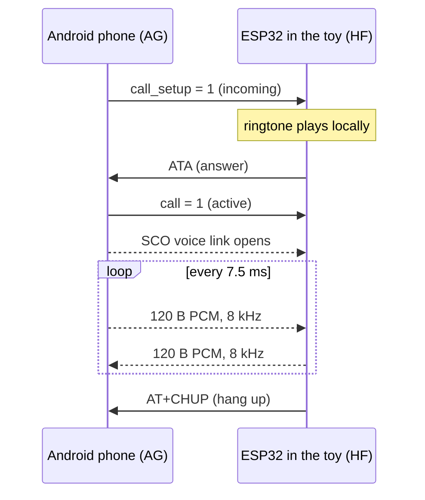
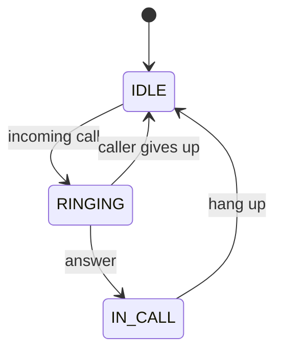
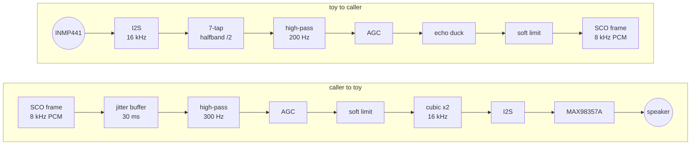

```
   .---------------.
   |  .---------.  |
   |  | 2:47 PM |  |     B A R B I E B T
   |  '---------'  |
   |               |     a toy flip phone
   |  [1] [2] [3]  |     that takes real calls
   |  [4] [5] [6]  |     over Bluetooth
   |  [7] [8] [9]  |
   |  [*] [0] [#]  |
   '---------------'
```

<div align="center">


</div>

---

A pink Barbie flip phone from a toy shelf, gutted and rewired as an actual phone.
It pairs with an Android handset as a hands-free unit, rings on its own, answers on a button,
and pipes the conversation through a speaker the size of a thumbnail.

No SIM. No cellular modem. Your real phone does the talking and the toy is the handset.

The goal is not clean audio. The goal is the exact tinny, slightly cursed sound a toy phone
makes when it works, plus a ringtone that sends you straight back to 2004.

## How a call moves



## Firmware states



## The signal chain

Both directions are rebuilt on the ESP32, because HFP over HCI hands the application raw 8 kHz
frames and nothing else. The I2S side runs at 16 kHz.



## Hardware

| Part | Job | Note |
|---|---|---|
| ESP32-32U devkit | brain, Bluetooth radio | classic ESP32 only. BLE-only chips (C3, S3, C6) have no HFP |
| MAX98357A | I2S class-D amp | runs off 5 V, drives an 8 ohm salvaged phone speaker |
| INMP441 | I2S MEMS microphone | 3.3 V only |
| LiPo 3.7 V + TP4056 + MT3608 | power | not wired yet |
| Original keypad | answer, hang up, ringtone select | not traced yet |

```
   ESP32 GPIO26 ──────┬─────────── MAX98357A BCLK
                      └─────────── INMP441   SCK
   ESP32 GPIO25 ──────┬─────────── MAX98357A LRC
                      └─────────── INMP441   WS
   ESP32 GPIO22 ────────────────── MAX98357A DIN
   ESP32 GPIO19 ────────────────── INMP441   SD

   5V  ─ MAX98357A VIN        3V3 ─ INMP441 VDD (never 5 V)
   GND ─ everything           INMP441 L/R ─ GND
```

Pins are Kconfig options under `Barbie BT`. Bench power is USB only. Do not connect the battery
and the boost converter while USB is plugged in.

## Build stages

Each stage is a menuconfig choice and was bought with its own flash cycle.

| Stage | What it proves | Status |
|---|---|---|
| 2 | I2S out: a 440 Hz tone from the amp | works |
| 3 | I2S in: live dBFS meter on the mic | works |
| 4 | HFP: pairs, sees incoming calls, answers, hangs up | works |
| 5 | ringtone, voice link, two-way audio bridge | audio flows both ways, quality tuning in progress |
| 6 | physical keypad: answer, hang up, ringtone select | planned |
| 7 | battery, charger, power switch | planned |
| 8 | everything inside the shell | planned |

## Ringtones

The target is a short set of Tamil film-song ringtones in the old polyphonic-phone style.
What ships today are placeholder melodies played as square waves. Real arrangements come later,
as synthesized note tables so there is nothing to license and nothing to store.

## Field notes

Things that cost hours and are now written down so they cost nobody else any.

| Symptom | Cause | Fix |
|---|---|---|
| Phone says it cannot route audio to the device | `BTDM_CTRL_BR_EDR_MAX_SYNC_CONN` defaults to 0, so the controller rejects every voice link | set it to 1 |
| Watchdog reset right after answering | audio task poked the stack before the voice link existed and drowned the log in errors | only bridge after the audio state reports connected |
| Mic audio never reaches the caller | the stack asks for 120 byte frames and discards anything shorter | answer a request with a full frame or return 0 |
| Crackle about ten times a second | a 1536 byte ring buffer wraps mid-frame and a short read looked like an underrun | size buffers as a multiple of the frame size |
| Flash fails with "Wrong boot mode" | clone devkit does not auto-reset into the bootloader | hold BOOT while esptool prints `Connecting` |

Debug trick worth stealing: key `x` dumps the last two seconds of both audio streams over serial
as hex, so the sound can be analyzed on a PC instead of argued about by ear.

## Build and flash

```
idf.py set-target esp32
idf.py menuconfig        # Barbie BT > stage
idf.py build
idf.py -p COMx flash monitor
```

Stage 5 serial keys: `a` answer, `h` hang up, `1` `2` `3` ringtone, `r` ring preview,
`c` `d` audio on and off, `x` dump audio.

## References

- ESP-IDF [HFP client API](https://docs.espressif.com/projects/esp-idf/en/latest/esp32/api-reference/bluetooth/esp_hf_client.html) and the `hfp_hf` example
- Bluetooth Hands-Free Profile specification
- [MAX98357A](https://www.analog.com/en/products/max98357a.html) I2S amplifier datasheet
- [INMP441](https://invensense.tdk.com/products/digital/inmp441/) I2S microphone datasheet
- Nokia, Sony Ericsson, and every phone that ever played a ringtone through a speaker the size of a coin
